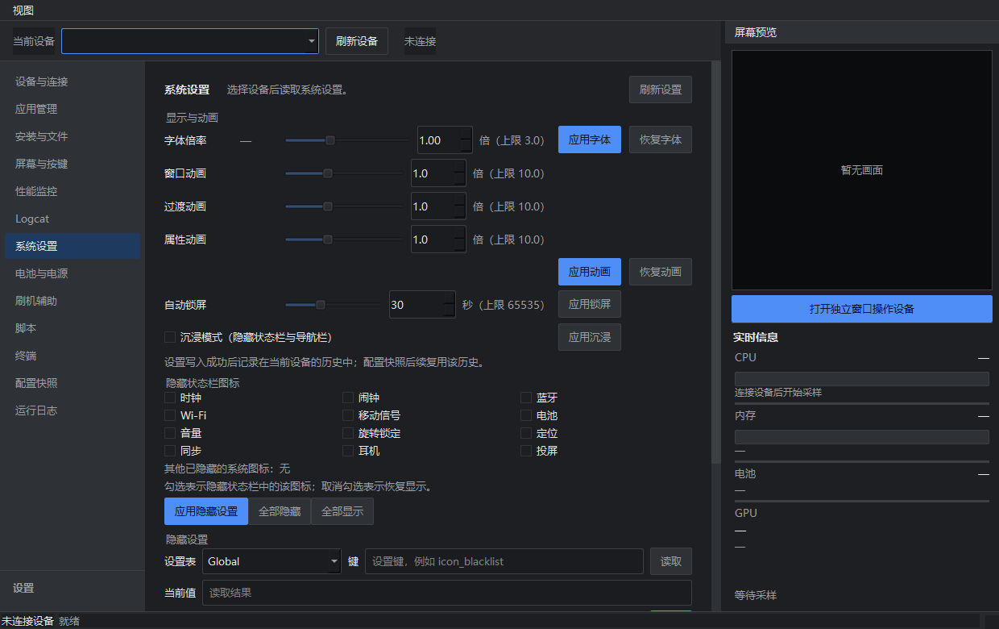
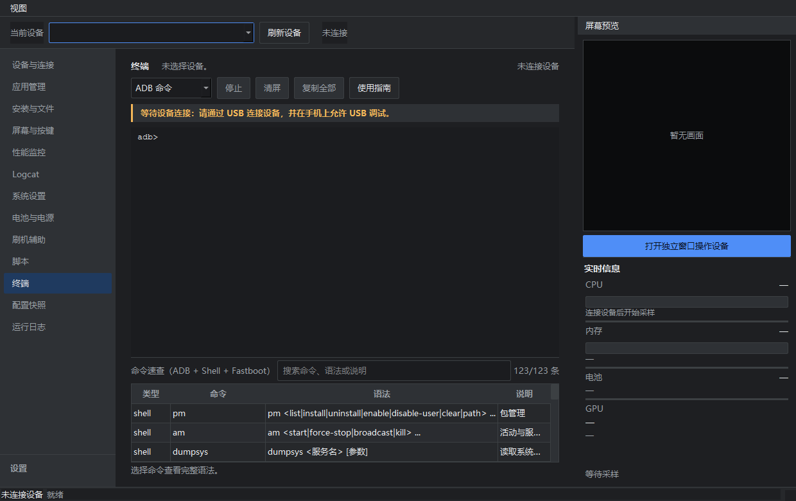

<p align="center">
  
</p>

<h1 align="center">spAdbBench</h1>

<p align="center">
  <strong>面向 Android 调试与设备管理的 Windows 桌面工具箱</strong><br>
  设备连接 · 应用管理 · 文件传输 · 屏幕控制 · 性能监控 · 自动化
</p>

<p align="center">
  
  
  
  
  
</p>

## 简介

spAdbBench 是一个使用 PySide6 构建的 Android 桌面工具箱，把日常设备调试、应用管理、文件操作、屏幕控制、性能观察和刷机辅助集中到一个图形界面中，减少在多个命令行窗口之间切换。

项目面向 Android 开发、测试、设备维护和刷机场景，提供完整版与轻量版两个版本。完整版集成 scrcpy 实时画面与独立控制窗口；轻量版聚焦设备管理与调试，安装体积更小。

## 功能特性

| 模块 | 主要能力 |
| --- | --- |
| 设备与连接 | ADB / Fastboot 设备识别与切换、USB 与无线连接、Android 11+ 二维码配对、自动刷新 |
| 应用管理 | 应用列表、启用/禁用、启动/停止、卸载、清除数据、APK 批量导出、Google 套件批量处理 |
| 安装与文件 | APK 安装、设备文件浏览、文件上传与下载、安装结果提示 |
| 屏幕与按键 | 分辨率与 DPI 调整和恢复、截图、21 个常用按键、按键状态反馈 |
| 实时画面 | scrcpy 画面预览、独立手机控制窗口、多设备并行、侧边按键与实时状态 |
| 性能监控 | CPU、内存、GPU、电池、温度、负载与运行时间采样，支持采样间隔设置 |
| Logcat | 日志级别、关键字与包名过滤，暂停/继续、清空、导出 |
| 系统设置 | 字体倍率、动画倍率、自动锁屏、沉浸模式、状态栏图标、Global/Secure/System 键值 |
| 电池与电源 | 电量、温度、电压、状态读取，模拟电池状态，定时采样与 CSV 导出 |
| 刷机辅助 | 重启到 Bootloader / Recovery / EDL、OEM 解锁与回锁命令、镜像刷写命令生成 |
| 脚本 | `.bat` 子集解释器，支持变量、标签跳转、超时/选择/暂停和 ADB 命令，执行前确认 |
| 终端 | ADB、设备 Shell、Fastboot 三种模式，Tab 补全、管道补全、命令速查 |
| 配置快照 | 设备配置导出、快照对比、选择性回滚 |
| 运行日志 | 命令、退出码、耗时、stdout/stderr 记录，JSONL 导出 |
| 主题 | 深色、浅色、跟随系统三种模式 |

## 界面预览

<p align="center">
  
  
</p>

<p align="center"><sub>系统设置 · 终端与命令速查</sub></p>

## 两个版本

| 版本 | 定位 | 目录 |
| --- | --- | --- |
| 完整版 | 设备管理、调试工具与 scrcpy 实时画面、独立控制窗口 | `spAdbBench/` |
| 轻量版 | 设备管理与调试工具集，安装体积更小 | `spAdbBench-with-no-video/` |

## 快速开始

### 使用发布包

1. 安装版：运行 `spAdbBench-Setup-1.0.0.exe`，选择安装目录并按向导完成。
2. 便携版：解压 `spAdbBench-1.0.0.zip`，运行 `spAdbBench.exe`。
3. 首次启动时按 Windows 提示授予管理员权限。

主程序通过清单申请管理员权限，用于在本地目录创建文件、写入配置，以及执行 ADB / Fastboot 操作。

### 运行准备

将 Android Platform-Tools 放入对应项目的 `platform-tools/` 目录；完整版将 scrcpy 运行文件放入 `spAdbBench/vendor/scrcpy/`。程序启动后会从项目目录自动识别 ADB、Fastboot 和 scrcpy。

## 从源码运行

完整版：

```powershell
git clone https://github.com/flhfm0214/spAdbBench.git
cd spAdbBench\spAdbBench
python -m venv .venv
.\.venv\Scripts\python.exe -m pip install -r requirements.txt
.\.venv\Scripts\python.exe main.py
```

轻量版：

```powershell
cd spAdbBench\spAdbBench-with-no-video
python -m venv .venv
.\.venv\Scripts\python.exe -m pip install -r requirements.txt
.\.venv\Scripts\python.exe main.py
```

## 构建与打包

分别在两个项目目录下安装构建依赖并生成 EXE：

```powershell
.\.venv\Scripts\python.exe -m pip install -r requirements-build.txt
powershell -NoProfile -ExecutionPolicy Bypass -File .\scripts\build_exe.ps1 -Clean -Zip
```

生成 `dist\spAdbBench\` / `dist\spAdbBench-no-video\` 目录以及对应 ZIP。安装程序使用 Inno Setup 6 编译：

```powershell
powershell -NoProfile -ExecutionPolicy Bypass -File .\scripts\build_installer.ps1
```

仓库根目录的 `build_release.ps1` 可以一次完成两个版本的 EXE、安装包和 SHA256 校验文件。

## 项目结构

```text
spAdbBench/
├─ spAdbBench/                    # 完整版源码
│  ├─ adbtool/
│  │  ├─ channels/                # scrcpy 服务、视频与控制通道
│  │  ├─ infrastructure/          # 配置、路径、进程、主题、日志
│  │  ├─ services/                # ADB、应用、电池、刷机、快照等服务
│  │  └─ ui/                      # 主窗口、页面、控件与对话框
│  ├─ config/                     # 设置模板与命令补全数据
│  ├─ packaging/                  # PyInstaller、Inno Setup、图标、版本信息
│  ├─ scripts/                    # 构建、安装包与验证脚本
│  ├─ tests/                      # 自动化测试
│  └─ main.py
├─ spAdbBench-with-no-video/      # 轻量版源码
├─ build_release.ps1              # 双版本发布构建
└─ README.md
```

## 技术栈

| 项目 | 用途 | 地址 |
| --- | --- | --- |
| Python 3.14 | 应用运行时 | https://www.python.org/ |
| PySide6 / Qt for Python | 桌面界面、控件与主题 | https://doc.qt.io/qtforpython-6/ |
| Android SDK Platform-Tools | ADB 与 Fastboot | https://developer.android.com/tools/releases/platform-tools |
| scrcpy | 实时画面、设备控制与独立窗口运行时 | https://github.com/Genymobile/scrcpy |
| wetest-scrcpy | scrcpy 协议的 Python 客户端 | https://pypi.org/project/wetest-scrcpy/ |
| qrcode | 无线调试二维码生成 | https://github.com/lincolnloop/python-qrcode |
| Pillow | 图像处理 | https://github.com/python-pillow/Pillow |
| PyInstaller | Windows EXE 打包 | https://github.com/pyinstaller/pyinstaller |
| Inno Setup | Windows 安装程序 | https://jrsoftware.org/isinfo.php |
| pytest / pytest-qt | 单元测试与 Qt 界面测试 | https://github.com/pytest-dev/pytest |
| ChineseSimplified.isl | Inno Setup 简体中文语言文件 | https://github.com/kira-96/Inno-Setup-Chinese-Simplified-Translation |

## 参考与致谢

- [scrcpy](https://github.com/Genymobile/scrcpy)：实时画面、控制通道和独立控制窗口的交互设计参考了 scrcpy。
- [wetest-scrcpy](https://pypi.org/project/wetest-scrcpy/)：Python 侧的 scrcpy 服务接入与协议处理参考了该项目。
- [Qt for Python](https://doc.qt.io/qtforpython-6/)：界面组件、布局和主题实现参考了官方文档与示例。
- [Android Platform-Tools](https://developer.android.com/tools/releases/platform-tools)：ADB / Fastboot 命令行为以官方工具为准。
- [Inno Setup 简体中文翻译](https://github.com/kira-96/Inno-Setup-Chinese-Simplified-Translation)：安装向导使用该项目的 `ChineseSimplified.isl`。

## 反馈

遇到问题或希望补充功能，欢迎在 [Issues](https://github.com/flhfm0214/spAdbBench/issues) 中反馈。
