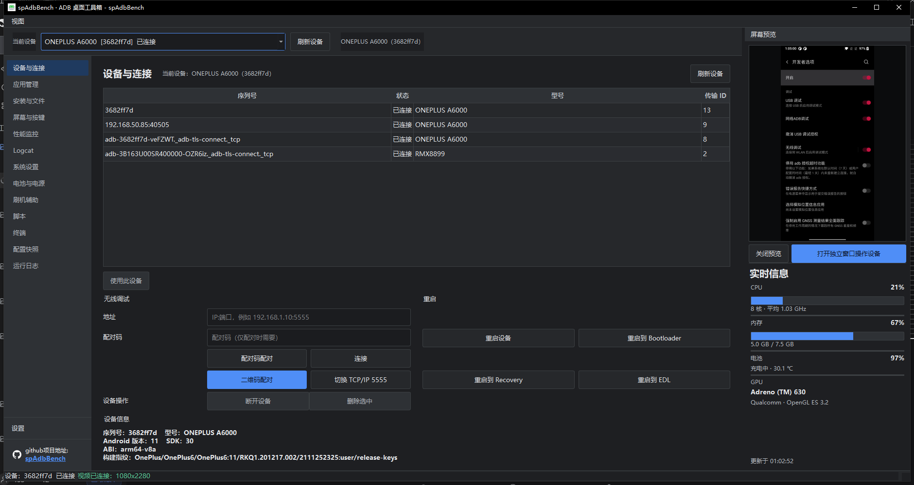
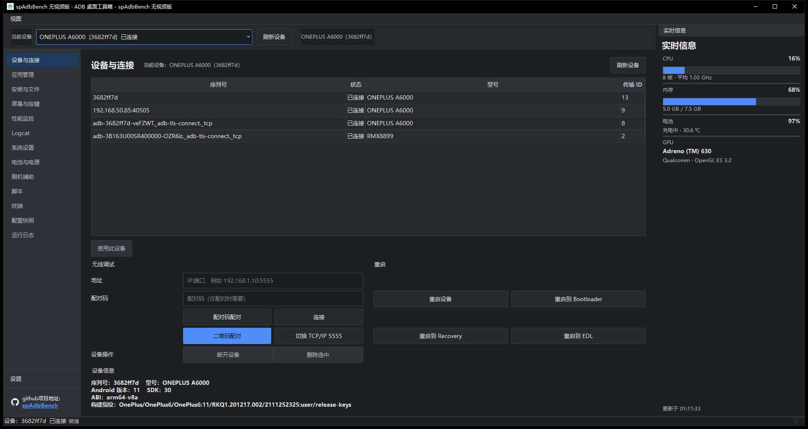
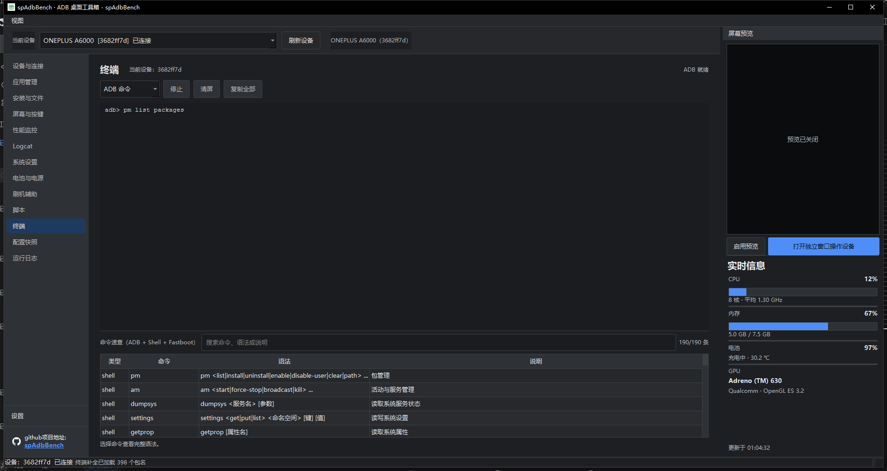

<p align="center">
  
</p>

<h1 align="center">spAdbBench</h1>

<p align="center">
  <strong>面向 Android 调试与设备管理的 Windows 桌面工具箱</strong><br>
  设备连接 · 应用管理 · 文件传输 · 屏幕控制 · 性能监控
</p>

<p align="center">
  
  
  
  
  
</p>

## 简介

spAdbBench 是一个使用 PySide6 构建的 Android 桌面工具箱，把 ADB、Fastboot、scrcpy 和常用设备操作集中到一个图形界面中，覆盖设备连接、应用管理、文件传输、屏幕控制、性能观察、日志查看、配置快照与刷机辅助。

完整版安装包内置 ADB、Fastboot 与 scrcpy 运行环境，轻量版安装包内置 ADB 与 Fastboot，连接设备后即可使用。源码运行时会自动探测项目目录或系统 PATH 中的 ADB，也可以在设置中指定路径。

项目提供完整版与轻量版：完整版集成 scrcpy 实时画面、独立手机控制窗口和多设备并行操作；轻量版聚焦设备管理与调试，安装体积更小。

## 界面预览

### 完整版

<p align="center">
  
</p>

<p align="center"><sub>完整版：设备列表、屏幕预览、实时信息与功能导航</sub></p>

### 轻量版

<p align="center">
  
</p>

<p align="center"><sub>轻量版：设备列表、实时信息与功能导航</sub></p>

## 特色功能

### 终端 Tab 补全与命令速查

终端把 ADB、设备 Shell、Fastboot 三种模式放在同一个输入界面。输入命令时按 `Tab`，补全会按当前模式、命令位置和上下文逐层匹配：

- 空输入按 `Tab`，列出当前模式的前 20 条命令。
- 唯一候选会原地补全并追加一个空格。
- 多候选会在终端内列出候选及语法，原命令保持不变。
- 软件包名异步加载，在 `pm`、`am` 等命令的包名参数位置参与补全。
- `|` 之后补全 `grep`、`sed`、`awk`、`cut`、`sort`、`uniq`、`head`、`tail`、`wc`、`xargs` 等管道命令及常用选项。
- `F1` 打开终端使用指南，下方命令速查支持按命令、语法或说明搜索，双击结果切换模式并填入输入框。

| 操作 | 结果 |
| --- | --- |
| 输入 `se`，按 `Tab` | 列出 `settings`、`setprop`、`sed`、`service`、`seq` 共 5 个候选及语法 |

补全规则保存在 `config/completions/`，可以编辑 `commands.json` 或新增 `<命令>.json`，保存后回到终端按 `Tab` 自动加载。

<p align="center">
  
</p>

<p align="center"><sub>只输入 se 后按 Tab，终端列出候选命令与语法</sub></p>

## 功能特性

| 模块 | 主要能力 |
| --- | --- |
| 设备与连接 | ADB / Fastboot 设备识别与切换、USB 与无线连接、Android 11+ 二维码配对、自动刷新 |
| 应用管理 | 应用列表、启用/禁用、启动/停止、卸载、清除数据、APK 批量导出、Google 套件批量处理 |
| 安装与文件 | APK 安装、拆分 APK 安装、设备文件浏览、文件推送与拉取 |
| 屏幕与按键 | 分辨率与 DPI 调整和恢复、截图、21 个常用按键、按键状态反馈 |
| 实时画面 | scrcpy 画面预览、独立手机控制窗口、多设备并行、侧边按键与实时状态 |
| 性能监控 | CPU、内存、GPU、电池、温度、负载与运行时间采样，支持采样间隔设置 |
| Logcat | 日志级别、关键字与包名过滤，暂停/继续、清空、导出 |
| 系统设置 | 字体倍率、动画倍率、自动锁屏、沉浸模式、状态栏图标、Global/Secure/System 键值 |
| 电池与电源 | 电量、温度、电压、状态读取，模拟电池状态，定时采样与 CSV 导出 |
| 刷机辅助 | 重启到 Bootloader / Recovery / EDL、OEM 解锁与回锁命令、镜像刷写命令生成 |
| 脚本 | `.bat` 子集解释器，支持变量、标签跳转、超时/选择/暂停和 ADB 命令，执行前确认 |
| 终端 | ADB、设备 Shell、Fastboot 三种模式；Tab 补全、管道补全、F1 使用指南、命令速查 |
| 配置快照 | 设备配置导出、快照对比、选择性回滚 |
| 运行日志 | 命令、退出码、耗时、stdout/stderr 记录，JSONL 导出 |
| 主题 | 深色、浅色、跟随系统三种模式 |

## 两个版本

| 版本 | 定位 | 目录 |
| --- | --- | --- |
| 完整版 | 设备管理、调试工具、scrcpy 实时画面与独立控制窗口 | `spAdbBench/` |
| 轻量版 | 设备管理与调试工具集，安装体积更小 | `spAdbBench-with-no-video/` |

## 安装

> **请以管理员身份运行安装程序。** 右键安装包，选择 **以管理员身份运行**。

| 版本 | 安装包 |
| --- | --- |
| 完整版 | `spAdbBench-Setup-1.0.0.exe` |
| 轻量版 | `spAdbBench-no-video-Setup-1.0.0.exe` |

从 [Releases](https://github.com/flhfm0214/spAdbBench/releases/latest) 下载安装版或便携版。

1. 右键对应的 `Setup` 文件，选择 **以管理员身份运行**。
2. 在安装向导中选择安装目录。
3. 按向导完成安装并启动程序。
4. 首次启动时在 Windows UAC 提示中选择 **是**。

完整版安装包内置 ADB、Fastboot 与 scrcpy 运行环境，轻量版安装包内置 ADB 与 Fastboot，启动后自动识别设备。便携版解压后运行 `spAdbBench.exe` 或 `spAdbBench-no-video.exe`。

### ADB / Fastboot 驱动

> **应用无法识别设备，或 ADB / Fastboot 无法运行时，请先下载并安装驱动。**

Platform-Tools 提供 `adb` 和 `fastboot`，USB Driver 负责让 Windows 识别 Android 设备。建议两项都安装完成后重新连接设备。

| 组件 | 用途 | 下载地址 |
| --- | --- | --- |
| Android SDK Platform-Tools | 提供 `adb.exe`、`fastboot.exe` | [下载](https://developer.android.com/tools/releases/platform-tools) |
| Google USB Driver | Windows 识别 Google / AOSP 设备 | [下载](https://developer.android.com/studio/run/win-usb) |
| OEM USB Drivers | 各品牌 Android 设备驱动 | [下载](https://developer.android.com/studio/run/oem-usb) |

安装驱动后重新连接设备，再点击应用顶部的 **刷新设备**。


## 使用说明

### 连接设备

1. 在 Android 设备上开启开发者选项与 USB 调试。
2. 使用 USB 连接电脑，在手机弹窗中允许 USB 调试授权。
3. 在应用顶部点击 **刷新设备**，在下拉框中选择要操作的设备。

无线连接可以点击 **二维码配对**，用 Android 11 及以上设备扫码配对；也可以填写 `IP:端口` 和配对码，先点 **配对码配对**，再点 **连接**。USB 设备可以点击 **切换 TCP/IP 5555** 开启无线调试。

### 主界面

- 顶部设备栏显示当前设备、连接状态和刷新入口。
- 左侧导航切换设备、应用、文件、屏幕、性能、Logcat、系统设置、电池、刷机、脚本、终端、快照和日志页面。
- 完整版右侧固定显示屏幕预览与实时信息，轻量版右侧显示实时信息。
- 底部状态栏显示当前设备、连接状态和操作结果。

### 常用操作

| 想做什么 | 入口 | 操作 |
| --- | --- | --- |
| 安装 APK | 安装与文件 | 浏览 APK → 安装 APK；拆分包使用拆分安装 |
| 管理应用 | 应用管理 | 勾选应用 → 启动、停止、卸载、清除数据或导出 APK |
| 截取屏幕 | 屏幕与按键 | 设置保存路径 → 截取屏幕 → 打开截图或目录 |
| 实时控制 | 完整版 → 屏幕预览 | 打开独立窗口操作设备，侧边栏发送按键 |
| 执行命令 | 终端 | 选择 ADB / Shell / Fastboot → 输入命令 → Tab 补全 → Enter |
| 备份配置 | 配置快照 | 导出当前配置 → 选择快照对比 → 回滚选中项 |
| 查看日志 | Logcat / 运行日志 | 按级别、关键字或包名过滤，导出结果 |
| 刷机操作 | 刷机辅助 | 选择重启模式，或生成 fastboot 解锁与刷写命令 |

### 设置

在左下角 **设置** 中可以调整主题、设备检测间隔、性能采样间隔、默认保存位置、ADB 路径和 `scrcpy-server` 路径。截图、快照、APK 导出和拉取文件都会保存到默认保存位置下的对应子目录。

## 从源码运行

完整版：

```powershell
git clone https://github.com/flhfm0214/spAdbBench.git
cd spAdbBench\spAdbBench
python -m venv .venv
.\.venv\Scripts\python.exe -m pip install -r requirements.txt
.\.venv\Scripts\python.exe main.py
```

轻量版：

```powershell
cd spAdbBench\spAdbBench-with-no-video
python -m venv .venv
.\.venv\Scripts\python.exe -m pip install -r requirements.txt
.\.venv\Scripts\python.exe main.py
```

程序按“设置中的 ADB 路径 → 项目 `platform-tools` → 系统 PATH”的顺序查找 ADB，可在 **设置 → 路径与资源** 中修改。完整版从 `vendor/scrcpy/` 加载 scrcpy 运行文件，也可以在设置中指定 `scrcpy-server` 路径。

## 构建与打包

分别在两个项目目录下安装构建依赖并生成 EXE：

```powershell
.\.venv\Scripts\python.exe -m pip install -r requirements-build.txt
powershell -NoProfile -ExecutionPolicy Bypass -File .\scripts\build_exe.ps1 -Clean -Zip
```

生成 `dist\spAdbBench\` / `dist\spAdbBench-no-video\` 目录以及对应 ZIP。安装程序使用 Inno Setup 6 编译：

```powershell
powershell -NoProfile -ExecutionPolicy Bypass -File .\scripts\build_installer.ps1
```

仓库根目录的 `build_release.ps1` 可以一次完成两个版本的 EXE、安装包和 SHA256 校验文件。

## 项目结构

```text
spAdbBench/
├─ spAdbBench/                    # 完整版源码
│  ├─ adbtool/
│  │  ├─ channels/                # scrcpy 服务、视频与控制通道
│  │  ├─ infrastructure/          # 配置、路径、进程、主题、日志
│  │  ├─ services/                # ADB、应用、电池、刷机、快照等服务
│  │  └─ ui/                      # 主窗口、页面、控件与对话框
│  ├─ config/                     # 设置模板与命令补全数据
│  ├─ packaging/                  # PyInstaller、Inno Setup、图标、版本信息
│  ├─ scripts/                    # 构建、安装包与验证脚本
│  ├─ tests/                      # 自动化测试
│  └─ main.py
├─ spAdbBench-with-no-video/      # 轻量版源码
├─ build_release.ps1              # 双版本发布构建
└─ README.md
```

## 使用的开源项目

| 项目 | 用途 | 地址 |
| --- | --- | --- |
| Python 3.14 | 应用运行时 | https://www.python.org/ |
| PySide6 / Qt for Python | 桌面界面、控件与主题 | https://doc.qt.io/qtforpython-6/ |
| Android SDK Platform-Tools | ADB 与 Fastboot | https://developer.android.com/tools/releases/platform-tools |
| scrcpy | 实时画面、设备控制与独立窗口运行时 | https://github.com/Genymobile/scrcpy |
| wetest-scrcpy | scrcpy 协议的 Python 客户端 | https://pypi.org/project/wetest-scrcpy/ |
| qrcode | 无线调试二维码生成 | https://github.com/lincolnloop/python-qrcode |
| Pillow | PIL 分支，Python 图像处理库 | https://github.com/python-pillow/Pillow |
| PyInstaller | Windows EXE 打包 | https://github.com/pyinstaller/pyinstaller |
| Inno Setup | Windows 安装程序 | https://jrsoftware.org/isinfo.php |
| pytest / pytest-qt | 单元测试与 Qt 界面测试 | https://github.com/pytest-dev/pytest |
| Inno Setup 简体中文语言包 | 安装向导中文文案 | https://github.com/kira-96/Inno-Setup-Chinese-Simplified-Translation |

## 参考项目与致谢

- [scrcpy](https://github.com/Genymobile/scrcpy)：实时画面、控制通道和独立控制窗口的交互设计参考了 scrcpy。
- [wetest-scrcpy](https://pypi.org/project/wetest-scrcpy/)：Python 侧的 scrcpy 服务接入与协议处理参考了该项目。
- [Qt for Python](https://doc.qt.io/qtforpython-6/)：界面组件、布局和主题实现参考了官方文档与示例。
- [Android Platform-Tools](https://developer.android.com/tools/releases/platform-tools)：ADB / Fastboot 命令行为以官方工具为准。
- [Inno Setup 简体中文翻译](https://github.com/kira-96/Inno-Setup-Chinese-Simplified-Translation)：安装向导使用该项目的 `ChineseSimplified.isl`。

## 反馈

遇到问题或希望补充功能，欢迎在 [Issues](https://github.com/flhfm0214/spAdbBench/issues) 中反馈。
